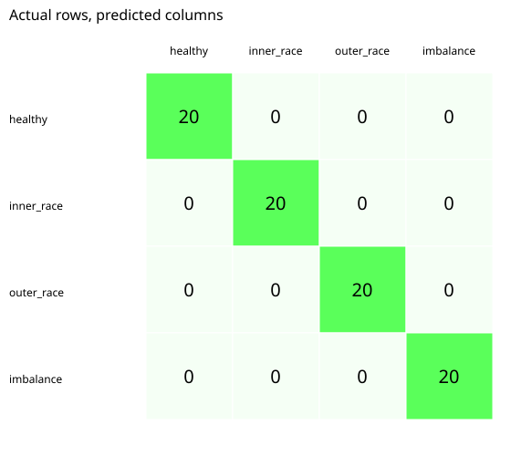

# Bearing Vibration Diagnosis

**Frequency-domain vibration features for interpretable rotating-machinery fault classification**

  

## Overview

This repository provides a dependency-free demonstration of vibration-based diagnostics for **healthy**, **inner-race**, **outer-race**, and **imbalance** conditions. It uses deterministic synthetic signals, simple time-domain and spectral features, and a nearest-centroid classifier to illustrate an inspectable fault-diagnosis pipeline.

## Experimental setup

The generator creates **80 signals for each of four conditions**, or 320 signals total, using seed `7`. Each signal has 256 samples, includes a small 8-bin shaft-frequency component, and contains Gaussian noise. Fault classes introduce class-specific frequency components in the synthetic spectrum.

| Simulated condition | Added spectral bin |
|---|---:|
| Imbalance | 18 |
| Outer-race fault | 30 |
| Inner-race fault | 45 |
| Healthy | No fault-specific component |

These are **discrete Fourier bins**, not physical frequencies in hertz or calculated bearing characteristic frequencies.

Five features characterize each signal: RMS, crest factor, and discrete Fourier amplitudes at bins 18, 30, and 45. A nearest-centroid model trained on 240 samples is assessed on 80 held-out samples.

## Reported synthetic-demo results

| Metric | Value |
|---|---:|
| Test samples | 80 |
| Classification accuracy | 100% |
| Test partition | 25% |



**Interpretation:** The classes are constructed with deliberately separable sinusoidal components. The perfect test result is a sanity check for the feature/classification pipeline, **not evidence of real-bearing diagnostic accuracy**.

## Evaluation artifacts

Summary results: [`results/metrics.json`](results/metrics.json). Per-class results: [`results/classification_report.csv`](results/classification_report.csv). The full confusion matrix is also provided as [CSV](results/confusion_matrix.csv).

## Limitations and next steps

Real-machine spectral signatures depend on bearing geometry, rotation speed, load, transfer paths and resonance. Further work should incorporate measured accelerometer datasets, shaft-speed variation, envelope analysis, fault severity, and machine-separated validation.

## Reproduce the results

```bash
git clone https://github.com/nabinkandel07/Bearing-Vibration-Diagnosis.git
cd Bearing-Vibration-Diagnosis
python src/run_demo.py
python -m unittest discover -s tests -v
```

**Requirements:** Python 3.10 or later is recommended. The current demonstration uses only the Python standard library; no third-party dependencies are required.

## Repository structure

```text
.
├── src/run_demo.py       # Runnable demonstration
├── tests/test_demo.py    # Verification tests
├── docs/
│   ├── METHODOLOGY.md    # Model and experimental design
│   ├── RESULTS.md        # Result interpretation and limitations
│   └── DATA_DICTIONARY.md
├── requirements.txt
├── CITATION.cff
└── README.md
```

See the `results/` directory for the committed evaluation artifacts and figures, except the robotics repository, which uses `Results/`.

## Documentation and citation

Detailed assumptions and experimental settings are documented in [Methodology](docs/METHODOLOGY.md). See [Results](docs/RESULTS.md) for interpretation and [Data Dictionary](docs/DATA_DICTIONARY.md) for exported fields. Citation metadata is provided in [CITATION.cff](CITATION.cff).

## Author

**Nabin Kandel**  
Control Science and Engineering, Zhejiang Sci-Tech University  
[GitHub](https://github.com/nabinkandel07) · [Email](mailto:nabinkandel60@gmail.com)
